<p align="center">
  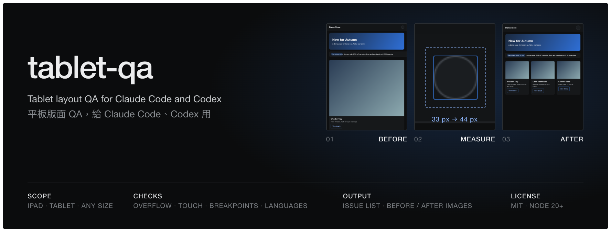
</p>

<p align="center">
  <b>iPad and responsive layout QA, an Agent Skill for Claude Code and Codex</b><br>
  平板與響應式（RWD）版面 QA，給 Claude Code、Codex 用的 Agent Skill
</p>

<p align="center">
  <a href="#english">English</a> · <a href="#zh-hant">繁體中文</a>
</p>

<p align="center">
  <a href="LICENSE">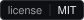</a>
  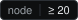
  <a href="https://github.com/jujuliac/tablet-qa/actions/workflows/test.yml">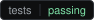</a>
</p>

<a name="english"></a>

## English

tablet-qa is an Agent Skill (SKILL.md) for Claude Code and Codex. It checks websites at simulated iPad and tablet sizes, around responsive breakpoints, or at any screen size you name (say, a 1366 × 768 laptop). Its Node.js + Playwright scripts flag possible overflow, clipped text, tap targets under 44px, breakpoint jumps and text that no longer fits in other languages, with screenshots. When you choose to fix something, it shoots the same spot before and after. The scripts also run without an AI assistant.

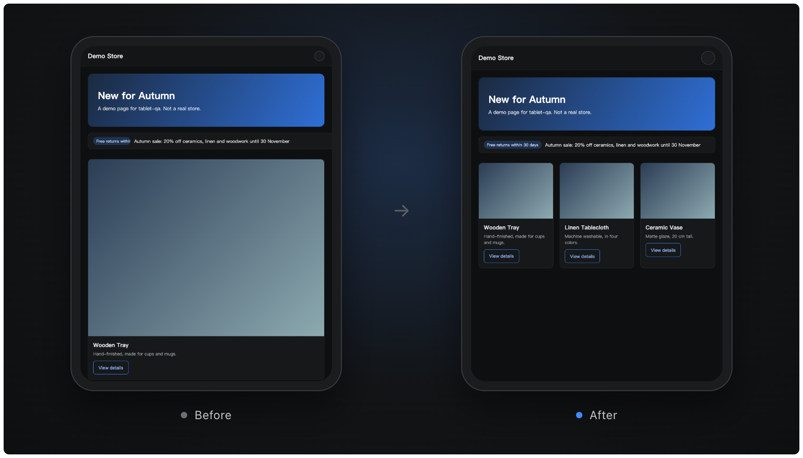

### What it checks

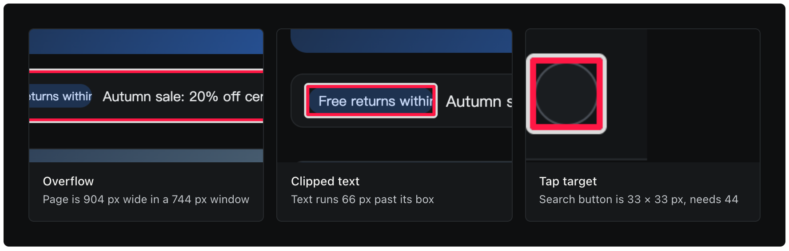

- **Overflow**: content cut off or pushed off screen, fixed bars that take too much height
- **Touch**: tap targets under 44px, buttons that overlap, features that only work on hover
- **Breakpoints**: sizes or line counts that jump one pixel either side of a breakpoint
- **Languages**: longer English words, Japanese line breaks, Korean words splitting

Above: real findings from the demo page. The scripts only flag *possible* problems. Whether it looks right and what to fix is your call.

### How it works

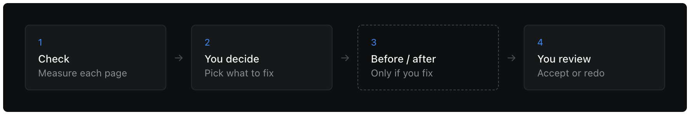

1. **Check**: the scripts measure each page at tablet sizes and take screenshots.
2. **You decide** what to fix.
3. **Before / after**: only if you fix something, the same spot is shot before and after.
4. **You review** the comparison.

<details>
<summary>See a comparison image the tool produces</summary>
<br>
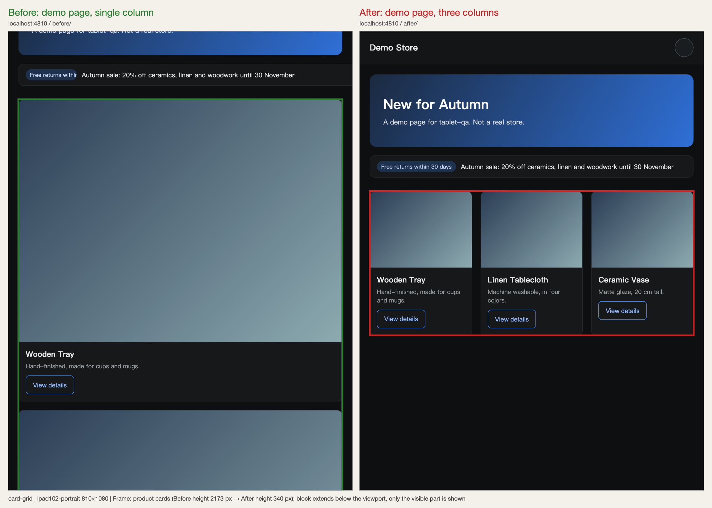
</details>

### Getting started

You need:

- [Claude Code](https://claude.com/claude-code) or [Codex](https://github.com/openai/codex)
- Node.js 20+
- Playwright in the site project you test: `npm i -D playwright`
- Google Chrome. No Chrome? Run `npx playwright install chromium` and it uses Playwright's bundled Chromium instead
- On Linux, a CJK font such as Noto Sans CJK. Without one, Chinese text renders as boxes and measurements can be wrong without any error reported
- A URL to test: a local dev server or a preview site

Steps:

1. Paste one of these into your terminal:

   Claude Code:

   ```bash
   git clone https://github.com/jujuliac/tablet-qa.git ~/.claude/skills/tablet-qa
   ```

   Codex:

   ```bash
   git clone https://github.com/jujuliac/tablet-qa.git ~/.agents/skills/tablet-qa
   ```

2. Open a new conversation in your site project.
3. Give it a command, including the URL. In Codex, start with "Use the tablet-qa skill to…" instead of `/tablet-qa`.

| When | Say |
|---|---|
| First check | `/tablet-qa first check, home and product pages at http://localhost:3000` |
| After a fix | `/tablet-qa regression, PR #12 changed the header` |
| Before handover | `/tablet-qa full` |

You can also just describe what you want checked in plain English.

Want to try it first? Say: "Do a test run of tablet-qa on `examples/demo-site`" ([demo notes](examples/demo-site/)).

**Test coverage.** GitHub Actions tests pass on Linux, Windows and macOS. They cover unit tests and check the demo page against expected findings in Google Chrome, Playwright's bundled Chromium and Playwright WebKit. The demo page was also checked in iPadOS Safari in the Xcode simulator: the measurements matched, except for viewport height because of Safari's toolbars.

**Using Codex?** Chrome can't start inside Codex's sandbox, so let Codex run the scripts outside it (approve when it asks, or use full access).

**No AI tool?** The two scripts are plain Node + Playwright. You can run them yourself and still get the reports and comparison images; you just write the config file by hand (commands in the full guide). AI tools other than Claude Code and Codex are untested.

### Limits

- Tablet sizes are simulated in a desktop browser. That is not the same as Safari on a real iPad, so check on a real device before launch.
- Visual quality still needs human review.
- Tap targets are only measured at touch sizes; a laptop size like 1366 × 768 skips that check.
- I've only used it on real sites on macOS, mostly in Claude Code.
- The skill's rules and report files are in Traditional Chinese. Before-and-after images default to Chinese labels, with English available via `compareLang: "en"`. The AI presents selected findings in your language.
- Results go to `tablet-qa-runs/` in your project. It holds screenshots and URLs, so add it to `.gitignore`.

### Full guide

Config, script options, output files, optional features: [docs/guide.en.md](docs/guide.en.md)

### Background

I wrote about the client project behind this skill and the layout issues it found: [tablet-qa: an open-source skill for checking iPad layouts](https://dev.to/jujuliac/tablet-qa-an-open-source-skill-for-checking-ipad-layouts-5ce) (dev.to).

---

<a name="zh-hant"></a>

## 繁體中文

tablet-qa 是給 Claude Code、Codex 用的 Agent Skill（SKILL.md），檢查網站在模擬的 iPad／平板尺寸、響應式（RWD）斷點前後，或任何你指定的螢幕尺寸（例如 1366 × 768 的筆電）下會不會破版。裡面的 Node.js＋Playwright 腳本會找出可能的橫向溢出、文字被裁切、點擊範圍小於 44px、斷點跳動和多語文字放不下，並附上截圖；你決定要修改時，會在同一個位置拍下修改前後的對照圖。腳本不用 AI 也能單獨執行。

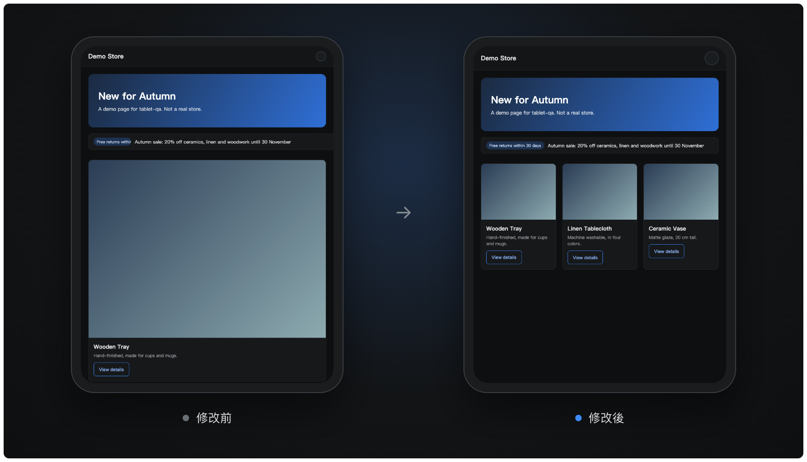

### 檢查什麼

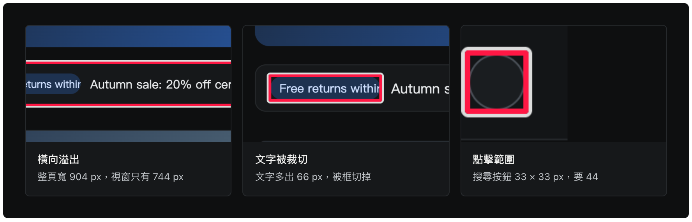

- **破版**：內容被切掉或超出畫面、固定列佔太多高度
- **觸控**：點擊範圍小於 44px、相鄰按鈕互相蓋到、只靠 hover 的功能
- **斷點**：在斷點前後 1px，尺寸或行數突然跳動
- **多語**：英文字太長、日文斷行、韓文詞被拆開

上圖是示範頁的實際量測結果。腳本只找出「可能有問題」的地方，好不好看、要不要改，由你判斷。

### 怎麼運作

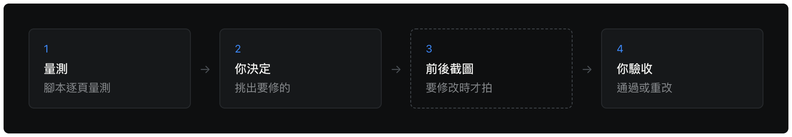

1. **量測**：腳本在平板尺寸下量每一頁，並截圖。
2. **你決定**要修哪些。
3. **前後截圖**：要修改時才需要，在同一個位置拍修改前、修改後。
4. **你驗收**對照圖。

<details>
<summary>看工具產出的對照圖</summary>
<br>

</details>

### 開始使用

你需要：

- [Claude Code](https://claude.com/claude-code) 或 [Codex](https://github.com/openai/codex)
- Node.js 20 以上
- 要測的網站專案裡裝好 Playwright：`npm i -D playwright`
- Google Chrome。沒有的話，先執行 `npx playwright install chromium`，會改用 Playwright 內建的 Chromium
- Linux 上要裝 Noto Sans CJK 等中日韓字型。缺少字型時，中文字會顯示成方框，量測結果可能出錯，也不會有錯誤提示
- 一個打得開的網址：本機開著的網站，或預覽站都可以

步驟：

1. 依你用的工具，把其中一行貼到終端機：

   Claude Code：

   ```bash
   git clone https://github.com/jujuliac/tablet-qa.git ~/.claude/skills/tablet-qa
   ```

   Codex：

   ```bash
   git clone https://github.com/jujuliac/tablet-qa.git ~/.agents/skills/tablet-qa
   ```

2. 在你的網站專案裡，開一個新對話。
3. 輸入指令，記得附上網址。Codex 裡把 `/tablet-qa` 換成「用 tablet-qa skill……」：

| 情境 | 你可以說 |
|---|---|
| 第一次檢查 | `/tablet-qa 首次，http://localhost:3000 的首頁和商品頁` |
| 修完確認 | `/tablet-qa 回歸，PR #12 改了頁首` |
| 交件前全站 | `/tablet-qa 完整` |

想先試試看？直接說：「用 tablet-qa 的 `examples/demo-site` 試跑一次」（[示範頁說明](examples/demo-site/)）。

**測試範圍：** GitHub Actions 測試已在 Linux、Windows 和 macOS 上通過，包含單元測試，以及用 Google Chrome、Playwright 內建的 Chromium 和 Playwright WebKit 檢查示範頁，確認結果符合預期。示範頁也在 Xcode 模擬器的 iPadOS Safari 中檢查過，量測數值一致，只有視窗高度因 Safari 工具列而不同。

**用 Codex 的話：** Codex 的沙盒裡開不了 Chrome，要讓它在沙盒外跑腳本（它詢問時同意，或改用完整權限）。

**不用 AI 工具也能用嗎？** 可以。兩支腳本是一般的 Node＋Playwright 程式，自己在終端機跑也會產出報告和對比圖，只是設定檔要自己寫（指令見完整說明）。Claude Code、Codex 以外的 AI 工具還沒測過。

### 限制

- 用桌機瀏覽器模擬平板尺寸，不等於 iPad 實機的 Safari，上線前仍建議用實機看一次。
- 版面好不好看，仍需要人來判斷。
- 點擊範圍只在觸控尺寸下量；1366 × 768 這類筆電尺寸不量這一項。
- 目前只在 macOS 上用來檢查過實際網站，主要搭配 Claude Code。
- skill 的規則和報告檔是繁體中文。前後對照圖的標籤預設為中文，可透過 `compareLang: "en"` 改成英文。AI 會用你的語言整理重點。
- 結果會存在你專案的 `tablet-qa-runs/`，裡面有截圖和網址，記得加進 `.gitignore`。

### 完整說明

設定檔、腳本參數、輸出檔案、選用功能：[docs/guide.zh-Hant.md](docs/guide.zh-Hant.md)

### 開發背景

這個 skill 來自一個客戶專案，整理的過程和找到的版面問題都寫在這篇文章裡：[tablet-qa：用來檢查網站 iPad 版面的開源 skill](https://medium.com/@juliachen25/tablet-qa-ipad-layout-check-e36e67d1f6dd)（Medium）。

---

[MIT](LICENSE) © jujuliac
