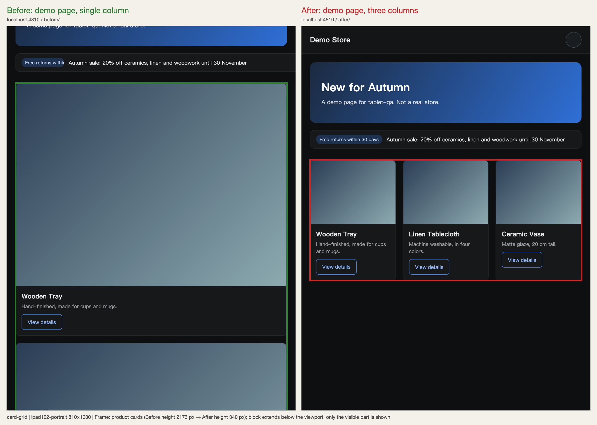

[← README](../README.md) · [繁體中文](guide.zh-Hant.md)

# tablet-qa: iPad and responsive layout QA for Claude Code and Codex

> The skill's rule documents and the reports it writes are in Traditional Chinese (繁體中文). Claude replies in the language you use, but the fixed wording inside the report files is Chinese. This guide is the English version of [guide.zh-Hant.md](guide.zh-Hant.md).

## What it is

An Agent Skill (SKILL.md) for [Claude Code](https://claude.com/claude-code) and [Codex](https://github.com/openai/codex), with standalone Node.js + Playwright scripts. You ask the AI to check how a website looks at **tablet sizes (mainly iPad) and the neighboring responsive breakpoints**:

- Broken layout: horizontal overflow, clipped text, scroll areas that don't show there is more content, fixed bars that take too much height
- Touch usability: tap targets smaller than 44px, adjacent buttons that overlap, features that only work on hover
- Jumps across breakpoints: line counts or sizes that change suddenly at b−1 / b / b+1
- Every language fits: English word length, Japanese line breaking, Korean words splitting

It produces a **reproducible issue list** and **before/after comparison images**. Machine measurement only produces "clues to look at"; a person looks at the screenshots and decides whether each one is a real problem.

## Who it is for

- Designers, PMs, QA: no tablet design files, and you need to accept a tablet layout the front end inferred
- Front-end engineers: you changed a breakpoint or a shared component and want to confirm no other page broke
- People who already use Claude Code (Claude reads the skill and runs the scripts; you just tell Claude what to check)

Not for: replacing real-device testing, automatically judging whether something "looks good", or testing native apps.

## Requirements

| Item | Notes |
|---|---|
| Claude Code or Codex | Loads the skill (Codex: install to `~/.agents/skills/tablet-qa`; Chrome cannot start inside the Codex sandbox, so let it run the scripts outside it) |
| Node.js 20 or later | The scripts are plain ESM with no other npm dependencies |
| Playwright | Installed in **the project you want to test**: `npm i -D playwright` (the scripts load it from `playwrightFrom` in the config file, or by searching upward for `node_modules`). Tested with: Playwright 1.64.1, Google Chrome 158, Node 24, macOS (Apple Silicon) |
| Browser | Uses Google Chrome by default. **Only if Chrome is not found does it fall back to Playwright's bundled Chromium** (first run `npx playwright install chromium` in your project folder; this downloads a test browser and does not change your website). The top-level `browser` field in the config file can pick one: `"auto"` (default), `"chrome"`, `"bundled"` (bundled Chromium), `"msedge"` (not tested so far). Set `"engine": "webkit"` on a profile to use WebKit (`npx playwright install webkit`). Building the before/after comparison images needs a Chromium-based browser. The fixed text drawn on those comparison images is Chinese by default; set the top-level `compareLang: "en"` to switch it to English (your own labels and notes are not translated). The report records the browser actually used, the Playwright version, and the operating system |
| Chinese fonts | Built into macOS and Windows. **On Linux, install Noto Sans CJK.** Otherwise Chinese text on the tested site and in the comparison image titles turns into empty boxes, measurements become inaccurate, and the scripts do not report an error |

## Install

```bash
# Personal skill (available in every project)
git clone https://github.com/jujuliac/tablet-qa.git ~/.claude/skills/tablet-qa
```

Or put it inside a project: `<project>/.claude/skills/tablet-qa/` (only that project uses it).

After installing, type `/tablet-qa` in Claude Code (in Codex, start with "Use the tablet-qa skill to…"; install it to `~/.agents/skills/tablet-qa` instead), or just say "run an iPad layout check".

There is currently no plugin version.

## Three kinds of checks

First, four terms: **sweep** (量測, measurement that finds clues), **shots** (對照截圖, comparison screenshots), **profile** (裝置尺寸, one device size, for example iPad portrait 810×1080), and **b−1 / b / b+1** (each breakpoint's width minus 1px, the width itself, and plus 1px).

Tell Claude which kind and which pages. If you are not specific, Claude picks one based on the situation and says so in its first reply.

| Kind | When to use it | You can say | Roughly how long |
|---|---|---|---|
| **First check** (首次檢查) | The first tablet QA for a project; no config file yet | "/tablet-qa first check, look at the home page and the product page" | A few minutes for a small scope; Claude first drafts a config file for you to confirm |
| **Regression check** (回歸驗收, default) | After a fix, to confirm it is fixed and nothing else broke | "/tablet-qa regression, PR #12 changed the header" | Usually 1–5 minutes when 1–3 pages changed |
| **Full check** (完整驗收) | Before handing over to a client, or after changing breakpoints or site-wide styles | "/tablet-qa full" | 30 minutes or more; run it in a terminal tab |

Flow of the first check: **list the issues → you decide on each (fix / leave as is / to be confirmed) → once you decide to fix and authorize the change, take the "before" shots first → fix → take the "after" shots → you accept → register the baseline**. The skill only does the checking; checking does not mean permission to change code or deploy. Items you decide to leave as is are written into the config file and are not raised again.

### Two scripts (this section and the next are for engineers; designers and PMs can use the three sentences above)

Claude runs them for you, and you can also run them yourself. The commands below assume you run them from the project root and installed the skill as a personal skill; if it is somewhere else, use the real path:

```bash
# Measurement: all pages × all sizes × b−1 / b / b+1 at every breakpoint; produces clues and evidence images
node ~/.claude/skills/tablet-qa/scripts/sweep.mjs qa/tablet/tablet-qa.json

# Regression: measure only the affected pages and compare, width by width, with the last accepted measurement
node ~/.claude/skills/tablet-qa/scripts/sweep.mjs qa/tablet/tablet-qa.json \
  --pages=home --profiles=ipad102-portrait --with-breakpoints --checks=regression \
  --compare=20261101-baseline:after --run=20261104-header-sweep

# Comparison screenshots: take the "before" shots first, before fixing
node ~/.claude/skills/tablet-qa/scripts/shots.mjs qa/tablet/tablet-qa.json \
  --cases=card-grid --site=after --run=20261104-card-grid-before

# After the fix, take the "after" shots and build the comparison image against the "before"
node ~/.claude/skills/tablet-qa/scripts/shots.mjs qa/tablet/tablet-qa.json \
  --cases=card-grid --site=after --baseline=20261104-card-grid-before --run=20261104-card-grid-after
```

Exit codes: 0 all succeeded; 1 there were failures (1 takes priority when there are failures); 2 command-line or config file error; 3 the pre-run check (smoke) did not pass; 4 no failures, but there is incomplete evidence (證據不完整); 130 interrupted with Ctrl-C (the run is marked `interrupted` and can no longer be used as a baseline). **0 only means the shots were taken or the measurement finished; it does not mean the check passed.** If building the comparison image fails, that is only recorded in the report and does not change the exit code to non-zero.

## Optional: reminder for background measurement (Stop hook)

When a measurement runs as a Claude background task, Claude may finish its reply and forget it is still running. With the Stop hook installed, it reminds Claude at that moment to tell you "still running, a few more minutes". It is only a reminder and cannot stop you from closing the conversation; for measurements longer than 10 minutes, run them in a terminal tab instead. For installation, see "Stop hook（選用）" in [references/執行規格.md](../references/執行規格.md).

## Optional: notification when finished (--notify)

Add `--notify` to shots or sweep (or set `"notify": true` in the config file) to get a system notification when a run finishes or is interrupted. The notification only says "measured, waiting to be reviewed"; it does not mean passed. On macOS you may need to allow it the first time. For details, see `--notify` in [references/執行規格.md](../references/執行規格.md).

## Minimal config file

Put it in your project (for example `qa/tablet/tablet-qa.json`), **not back inside the skill folder**.

```json
{
  "sites": {
    "after": { "url": "https://staging.example.com", "label": "修改後 abc1234" }
  },
  "profiles": {
    "ipad102-portrait":  { "width": 810,  "height": 1080, "touch": true },
    "ipad102-landscape": { "width": 1080, "height": 810,  "touch": true },
    "desktop":           { "width": 1440, "height": 900,  "touch": false }
  },
  "breakpoints": [768, 1024, 1280],
  "pages": [
    { "id": "home", "path": "/" },
    { "id": "about", "path": "/about" }
  ],
  "cases": [
    {
      "id": "card-grid",
      "path": "/",
      "profiles": ["ipad102-portrait"],
      "expect": "主視覺下方的三張卡片在平板並排，不是單欄撐滿",
      "capture": { "mode": "element", "target": { "css": "main section:nth-of-type(2)" } }
    }
  ]
}
```

(The `label` and `expect` values above are example text in Chinese. `expect` says: the three cards under the hero sit side by side on a tablet instead of stretching in a single column.)

- `sweep` needs `sites`, `profiles` and `pages`; `breakpoints` is optional, and without it breakpoints are not measured. `shots` also needs `cases`.
- Results are written by default to `tablet-qa-runs/` next to the config file. Add it to the project's `.gitignore`: it holds full-page screenshots, URLs, and a copy of the config file (including test data typed with `fill`). The scripts only connect to the URLs in the config file and send no data anywhere else.
- For all fields (`acceptedExceptions`, `steps` actions, `require`, `versionUrl`, the `before` site, and so on), see [references/執行規格.md](../references/執行規格.md).

## Try the demo page

`examples/demo-site/` is a fake shop page with a before version and an after version, which you can use for a trial run. For the steps and commands, see [examples/demo-site/README.md](../examples/demo-site/README.md).

## What the output looks like

Each run writes one folder, `<out>/<run name>/`:

| File | Contents |
|---|---|
| `sweep-report.md` | Report in Chinese: summary, coverage table (whether each page at each width was measured), clues to look at (grouped, with evidence images), accepted exceptions, scope not measured |
| `evidence/<site>/G01-….png` | Representative screenshots with the element boxed in red: the first 40 groups and every "fixed bar takes height" group; in a regression comparison, also the first 40 "newly appeared" groups. Other groups have no image |
| `results/<page id>.json` | Full raw measurement for each page |
| `shots-report.md` | For each case, "what counts as fixed", side-by-side before/after, and screenshot differences ranked |
| `compare/<case>-<profile>.png` | **Before/after comparison image** (see below) |
| `ctx/`, `diff/` | Context screenshots, and difference images with the differences boxed in red |
| `sweep-results.json`, `shots-results.json`, `run-meta.json`, `progress.jsonl`, `tablet-qa-config.json` | Summary tables, run records, and a copy of the config file used for this run |
| `<out>/runs.log` (outside the run folder) | Start and end records shared by all runs |

### Before/after comparison image



The example image was made from the demo page in `examples/demo-site/`: at tablet width, the product cards change from a single column to three columns. The left side is before, the right side is after, and the frames mark the block being compared.

- Before is on the left and after on the right; each has a green or red frame around the block this case is about
- At the top are the version labels and URLs; at the bottom are the case ID, the device size, and the before/after change in block height
- The context screenshot scrolls the block to about 160px below the top of the viewport and captures it together with the header, so you can see where it sits on the page
- The screenshot difference percentage is only used to **decide which image to look at first**; it never decides pass or fail automatically
- Only cases with `capture.mode: "element"` get the frames and the height comparison; `viewport` uses the original image with no frame; `clip` and `fullPage` get no comparison image, only the two original images

## Limits

- **Emulation is not real Safari on a real device.** By default it uses Chrome with touch emulation (`pointer: coarse`, an iPad user agent). Switching to WebKit is still Playwright's WebKit, not the Safari on your client's iPad. Things like the height when the address bar collapses, real gestures, video autoplay, and low-power mode can only be seen on a real device. The report states which level was tested.
- Machines can measure overflow, clipping, and tap target size, but **cannot measure whether it looks good**. Alignment, spacing, and the balance of a whole section need a person looking at the screenshots.
- Measurement is at discrete points: the width listed for each clue is the width where the problem was measured, and it does not mean the widths in between were checked.
- Motion (parallax, transitions, entrance animations) cannot be proven by a still screenshot; record a video or scroll the page yourself.
- Steps (clicks, filling forms) may create data on the website. Use only a test environment and test data.
- I've only used it on real sites on macOS. CI passes on Linux, Windows and macOS, covering unit tests and demo page checks. The demo checks use Google Chrome, Playwright's bundled Chromium and Playwright WebKit. On Windows, the demo steps run in Git Bash. The Windows command examples (`~`, `\` line continuation) have not been verified: write them on one line and replace `~` with the full path. The Stop hook example uses macOS / Linux shell syntax; on Windows replace it with the real path.
- For before/after comparison, use the same machine and the same browser where you can. The bundled Chromium cannot play H.264 (mp4) video, so pages with video may differ from Chrome; fonts differ across operating systems, so line counts and widths also change. When shots compares against a baseline made in a different browser, it warns (a warning only, not a block).
- The finished notification (`--notify`) only works on macOS and Linux (`notify-send`); Windows gets no notification.
- When Playwright is not under a standard `node_modules/` folder, the lookup uses a Node internal API (`Module._initPaths`) that may stop working in later Node versions. Point `playwrightFrom` at a project folder that contains `node_modules/`.
- The design judgment rules (`references/判斷/`) come almost entirely from **one** multilingual content website and have not been validated on a second project; check the preferences and cases against your own project.
- The skill's rule documents and reports are in Traditional Chinese; the README and this guide are available in English.

## Tests

Run these inside the skill folder:

```bash
npm test                # tests that need no browser (old/new comparison, screenshot diff, run records, Stop hook, browser fallback, config small fixes)
npm run test:browser    # measurement and classification (needs Playwright and a browser)
npm run test:all        # runs both; any failure exits non-zero
```

When `test:browser` is run without a config file, it searches for Playwright upward from the current folder and then upward from the skill folder. The skill usually lives in `~/.claude/skills/`, where searching upward will not find your project, so run it from **a website project folder that has Playwright installed**:

```bash
node "<skill path>/scripts/test/measure.test.mjs"
```

Or pass a config file (it uses the config's `playwrightFrom` and `browser`): `node "<skill path>/scripts/test/measure.test.mjs" <config file.json>`. If Playwright or a browser is not found, it exits non-zero with an explanation; it does not install anything automatically and does not pretend to pass.

## Files

```
SKILL.md                 Main flow that Claude reads
references/執行規格.md    Config file, measurement definitions, output format
references/技術坑.md      Pitfalls: emulation, size tables, screenshots, Tailwind, Next.js
references/子代理判讀.md  Format for asking a subagent to look at the images first
references/判斷/          Basis for judging screenshots (general + site types)
scripts/                 sweep.mjs, shots.mjs, plus lib/ and test/
```

## License

MIT. See `LICENSE`.
