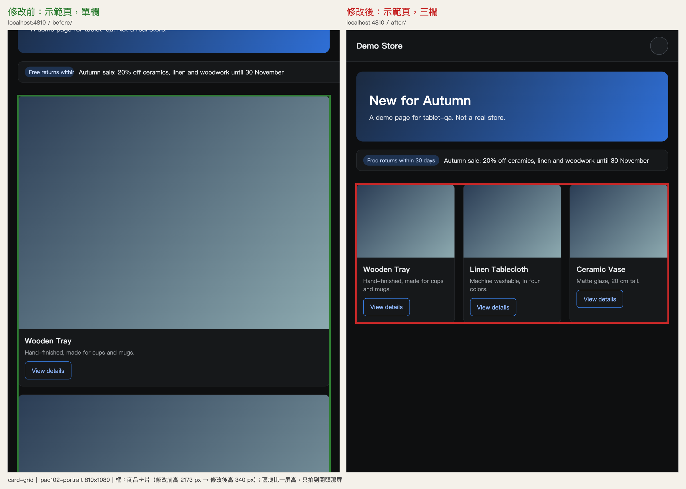

[← README](../README.md) · [English](guide.en.md)

# tablet-qa：平板與響應式版面 QA（Claude Code、Codex）

## 這是什麼

給 [Claude Code](https://claude.com/claude-code)、[Codex](https://github.com/openai/codex) 用的 Agent Skill（SKILL.md），腳本是 Node.js＋Playwright，也能單獨執行。請 AI 檢查網站在**平板尺寸（以 iPad 為主）和相鄰響應式斷點**的樣子：

- 有沒有破版：橫向溢出、文字被裁切、內捲區看不出還有內容、固定列佔太多高度
- 觸控順不順手：點擊範圍小於 44px、相鄰按鈕互相蓋到、只靠 hover 的功能
- 跨斷點會不會「跳一下」：行數、尺寸在 b−1／b／b+1 突然變化
- 每個語系都放得下：英文字長、日文斷詞、韓文詞拆開

產出**可重現的問題清單**和**修改前後對比圖**。機器量測只產生「待看的線索」，最後由人看截圖決定是不是問題。

## 適合誰

- 設計師、PM、QA：沒有平板設計稿、要驗收前端推論出來的平板版
- 前端工程師：改了斷點或共用元件，想確認沒把其他頁改壞
- 已經在用 Claude Code 的人（skill 由 Claude 讀、由 Claude 執行腳本；你用中文跟 Claude 說要檢查什麼即可）

不適合：要取代實機測試、要自動判定「好不好看」、要測原生 App。

## 需求

| 項目 | 說明 |
|---|---|
| Claude Code 或 Codex | 用來載入 skill（Codex 裝在 `~/.agents/skills/tablet-qa`；Codex 沙盒裡開不了 Chrome，要讓它在沙盒外跑腳本） |
| Node.js 20 以上 | 腳本是純 ESM，沒有其他 npm 依賴 |
| Playwright | 裝在**你要測的專案**裡：`npm i -D playwright`（腳本從設定檔的 `playwrightFrom` 或往上找 `node_modules` 載入）。實測：Playwright 1.64.1、Google Chrome 158、Node 24，macOS（Apple Silicon） |
| 瀏覽器 | 預設用 Google Chrome；**找不到 Chrome 才改用 Playwright 內建的 Chromium**（要先在你的專案資料夾執行 `npx playwright install chromium`，這會下載測試用瀏覽器，不會改網站）。設定檔頂層的 `browser` 可以指定：`"auto"`（預設）、`"chrome"`、`"bundled"`（內建 Chromium）、`"msedge"`（目前沒實測過）。profile 設 `"engine": "webkit"` 可改用 WebKit（`npx playwright install webkit`）。前後對比圖的合成需要 Chromium 系瀏覽器。 對比圖上的固定字預設是中文，頂層 `compareLang: "en"` 可改成英文（自己寫的 label、備註不會被翻譯）。報告會記下實際用的瀏覽器、Playwright 版本和作業系統 |
| 中文字型 | macOS、Windows 內建即可；**Linux 要裝 Noto Sans CJK**，否則被測網站的中文和對比圖的標題都會變方框，量測不準，而且腳本不會報錯 |

## 安裝

```bash
# 個人 skill（所有專案都能用）
git clone https://github.com/jujuliac/tablet-qa.git ~/.claude/skills/tablet-qa
```

或放在專案裡：`<專案>/.claude/skills/tablet-qa/`（只有這個專案用）。

裝好後在 Claude Code 輸入 `/tablet-qa`（Codex 要裝在 `~/.agents/skills/tablet-qa`，開頭改說「用 tablet-qa skill……」），或直接說「幫我做 iPad 版面檢查」。

目前不提供 plugin 版。

## 三種檢查

先認識四個詞：**sweep**（量測，找線索）、**shots**（對照截圖）、**profile**（一種裝置尺寸，例如 iPad 直向 810×1080）、**b−1／b／b+1**（每個斷點的前 1px、本身、後 1px）。

跟 Claude 說哪一種、看哪些頁；沒說清楚時 Claude 會依情況推定並在第一則回覆說明。

| 種類 | 什麼時候用 | 你可以這樣說 | 大約時間 |
|---|---|---|---|
| **首次檢查** | 專案第一次做平板 QA，還沒有設定檔 | 「/tablet-qa 首次，先看首頁和商品頁」 | 小範圍幾分鐘；Claude 會先做設定檔初稿給你確認 |
| **回歸驗收**（預設） | 修過之後，確認修好、沒改壞 | 「/tablet-qa 回歸，PR #12 改了頁首」 | 改到 1–3 頁通常 1–5 分鐘 |
| **完整驗收** | 交給客戶前、改了斷點或全站樣式 | 「/tablet-qa 完整」 | 30 分鐘以上，用終端機分頁跑 |

首次檢查的流程：**列問題 → 你逐項決定（要修／不改／待確認）→ 你決定要修、也授權修改後，修之前先拍「修改前」→ 修 → 拍「修改後」→ 你驗收 → 登記基準**。這個 skill 只負責檢查；檢查本身不代表可以改程式或部署。決定不改的會寫進設定檔，之後不再重複提。

### 兩支腳本（這節和下一節給工程師；設計師／PM 用上面那三句話即可）

Claude 會替你執行，也可以自己跑。以下假設在專案根目錄執行、skill 裝在個人 skill 路徑；裝在別處就換成實際路徑：

```bash
# 量測：所有頁 × 所有尺寸 × 每個斷點的 b−1／b／b+1，產出線索與證據圖
node ~/.claude/skills/tablet-qa/scripts/sweep.mjs qa/tablet/tablet-qa.json

# 回歸：只量受影響的頁，跟上次已驗收的量測逐寬度比
node ~/.claude/skills/tablet-qa/scripts/sweep.mjs qa/tablet/tablet-qa.json \
  --pages=home --profiles=ipad102-portrait --with-breakpoints --checks=regression \
  --compare=20261101-baseline:after --run=20261104-header-sweep

# 對照截圖：修之前先拍「修改前」
node ~/.claude/skills/tablet-qa/scripts/shots.mjs qa/tablet/tablet-qa.json \
  --cases=card-grid --site=after --run=20261104-card-grid-before

# 修完後拍「修改後」，跟修改前合成對比圖
node ~/.claude/skills/tablet-qa/scripts/shots.mjs qa/tablet/tablet-qa.json \
  --cases=card-grid --site=after --baseline=20261104-card-grid-before --run=20261104-card-grid-after
```

結束碼：0 全部成功、1 有失敗（有失敗時優先回 1）、2 命令或設定檔錯誤、3 起跑前檢查沒過、4 沒有失敗但有「證據不完整」、130 被 Ctrl-C 中斷（run 標成 interrupted，之後不能當基準）。**0 只代表拍完、量完，不代表驗收通過**；對比圖合成失敗只記在報告裡，不會讓結束碼變成非 0。

## 選用：背景量測提醒（Stop hook）

量測跑在 Claude 的背景工作時，Claude 可能一結束回覆就忘了還在跑。裝上 Stop hook，它會在這時提醒 Claude 先告訴你「還在跑、還要幾分鐘」。只是提醒，擋不住關對話；超過 10 分鐘的量測建議改用終端機分頁跑。安裝方式見 [references/執行規格.md](../references/執行規格.md) 的「Stop hook（選用）」。

## 選用：跑完通知（--notify）

shots、sweep 加 `--notify`（或設定檔寫 `"notify": true`），跑完或被中斷時跳一則系統通知。通知只說「量完、待判讀」，不代表通過。macOS 第一次可能要允許。細節見 [references/執行規格.md](../references/執行規格.md) 的 `--notify`。

## 試跑示範頁

`examples/demo-site/` 是一個假的商店頁，有修改前、修改後兩版，可以拿來試跑。步驟和指令見 [examples/demo-site/README.md](../examples/demo-site/README.md)。

## 設定檔最小範例

放在你的專案裡（例如 `qa/tablet/tablet-qa.json`），**不要放回 skill 資料夾**。

```json
{
  "sites": {
    "after": { "url": "https://staging.example.com", "label": "修改後 abc1234" }
  },
  "profiles": {
    "ipad102-portrait":  { "width": 810,  "height": 1080, "touch": true },
    "ipad102-landscape": { "width": 1080, "height": 810,  "touch": true },
    "desktop":           { "width": 1440, "height": 900,  "touch": false }
  },
  "breakpoints": [768, 1024, 1280],
  "pages": [
    { "id": "home", "path": "/" },
    { "id": "about", "path": "/about" }
  ],
  "cases": [
    {
      "id": "card-grid",
      "path": "/",
      "profiles": ["ipad102-portrait"],
      "expect": "主視覺下方的三張卡片在平板並排，不是單欄撐滿",
      "capture": { "mode": "element", "target": { "css": "main section:nth-of-type(2)" } }
    }
  ]
}
```

- `sweep` 要 `sites`、`profiles`、`pages`；`breakpoints` 選填，沒寫就不量斷點。`shots` 另外要 `cases`。
- 結果預設寫在設定檔旁的 `tablet-qa-runs/`，請加進專案的 `.gitignore`：裡面有整頁截圖、網址、設定檔副本（含 `fill` 填的測試資料）。腳本只連設定檔裡的網址，不回傳任何資料到別處。
- 完整欄位（`acceptedExceptions`、`steps` 操作、`require`、`versionUrl`、`before` 網站…）見 [references/執行規格.md](../references/執行規格.md)。

## 輸出長怎樣

每次執行一個資料夾 `<out>/<run 名>/`：

| 檔案 | 內容 |
|---|---|
| `sweep-report.md` | 中文報告：摘要、覆蓋表（每頁每寬度量完沒）、需要看的線索（分組、附證據圖）、已接受的例外、沒量到的範圍 |
| `evidence/<site>/G01-….png` | 代表截圖，紅框標元素：前 40 組、所有「固定列佔高」，回歸比對時再加「這次新出現」的前 40 組；其他組沒有圖 |
| `results/<頁面 id>.json` | 每頁的完整原始量測 |
| `shots-report.md` | 每個案例的「怎樣算修好」、前後並排、截圖差異排序 |
| `compare/<案例>-<profile>.png` | **前後對比圖**（見下） |
| `ctx/`、`diff/` | 情境截圖、紅框標出差異的差異圖 |
| `sweep-results.json`、`shots-results.json`、`run-meta.json`、`progress.jsonl`、`tablet-qa-config.json` | 總表、執行紀錄、當次設定檔副本 |
| `<out>/runs.log`（在 run 資料夾外） | 所有 run 共用的開始／結束紀錄 |

### 前後對比圖



範例圖用 `examples/demo-site/` 的示範頁產生：平板寬度時，商品卡片從單欄改成三欄。左邊是修改前，右邊是修改後，框是比對區塊。

- 左邊修改前、右邊修改後，各自用綠框／紅框標出這個案例要看的區塊
- 上方是版本標籤和網址；底部是案例編號、裝置尺寸、區塊高度的前後變化
- 情境截圖會把區塊捲到視窗上方約 160px，連同頁首一起拍，看得出它在整頁裡的位置
- 截圖差異比例只用來**排序先看哪張**，不會自動判定通過
- 只有 `capture.mode: "element"` 的案例有框和高度比較；`viewport` 用原圖、沒有框；`clip`、`fullPage` 沒有對比圖，只有兩張原圖

## 限制

- **模擬不等於實機 Safari。** 預設用 Chrome 開觸控模擬（`pointer: coarse`、iPad UA），換成 WebKit 也只是 Playwright 的 WebKit，不是客戶 iPad 上的 Safari。網址列收合的高度、真實手勢、影片自動播放、低耗電模式，只有實機看得到。報告會寫明驗到哪一層。
- 機器量得到溢出、裁切、點擊範圍，**量不到好不好看**。對齊、留白、整區平衡要人看截圖。
- 量測是離散測點：每組線索的寬度是「量到問題的寬度」，不代表中間寬度都驗過。
- 動態效果（視差、轉場、進場動畫）靜態截圖證明不了，要錄影或實際捲動看。
- 操作步驟（點擊、填表）可能在網站上產生資料，請只用測試環境和測試資料。
- 目前只在 macOS 用過；Windows、Linux 沒實測。Windows 的命令範例（`~`、`\` 續行）沒驗過，請寫成一行、把 `~` 換成完整路徑。Stop hook 的範例是 macOS／Linux shell 寫法，Windows 要換成實際路徑。
- 前後對照盡量用同一台機器、同一個瀏覽器。內建 Chromium 不能播 H.264（mp4）影片，有影片的頁面可能跟 Chrome 不一樣；跨作業系統字型不同，行數和寬度也會變。shots 比對基準時瀏覽器不同會警告（只警告，不阻擋）。
- 跑完通知（`--notify`）只支援 macOS 和 Linux（`notify-send`）；Windows 不會通知。
- 找 Playwright 時，套件不在標準 `node_modules/` 底下會用到 Node 內部 API（`Module._initPaths`），之後的 Node 版本可能失效；建議讓 `playwrightFrom` 指到含 `node_modules/` 的專案資料夾。
- 設計判斷的規則（`references/判斷/`）目前幾乎都來自**同一個**多語系內容型網站，還沒在第二個專案驗證；偏好和案例請依你的專案確認。
- skill 的規則文件和報告是繁體中文；README 和這份說明都有英文版。

## 測試

在 skill 資料夾裡執行：

```bash
npm test                # 不需要瀏覽器的測試（新舊比對、截圖差異、run 紀錄、Stop hook、瀏覽器備援、設定檔小修）
npm run test:browser    # 量測與分類（需要 Playwright 和瀏覽器）
npm run test:all        # 兩者都跑；任何一項失敗都會以非 0 結束
```

`test:browser` 不傳設定檔時，會從目前資料夾往上、再從 skill 資料夾往上找 Playwright。skill 通常放在 `~/.claude/skills/`，往上找不到你的專案，所以請在**有裝 Playwright 的網站專案資料夾**執行：

```bash
node "<skill 路徑>/scripts/test/measure.test.mjs"
```

或傳設定檔（會用設定檔的 `playwrightFrom` 和 `browser`）：`node "<skill 路徑>/scripts/test/measure.test.mjs" <設定檔.json>`。找不到 Playwright 或瀏覽器時會以非 0 結束並說明，不會自動安裝，也不會假裝通過。

## 檔案

```
SKILL.md                 Claude 讀的主流程
references/執行規格.md    設定檔、量測定義、輸出格式
references/技術坑.md      模擬、尺寸表、截圖、Tailwind、Next.js 的坑
references/子代理判讀.md  請子代理先看圖時的格式
references/判斷/          看截圖的判斷依據（通用＋網站類型）
scripts/                 sweep.mjs、shots.mjs 與 lib/、test/
```

## 授權

MIT，見 `LICENSE`。
